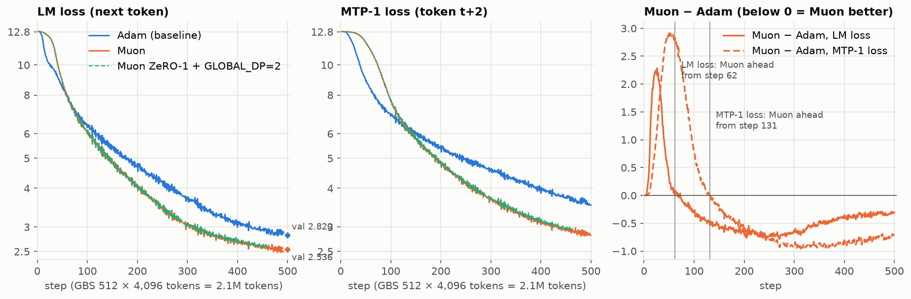
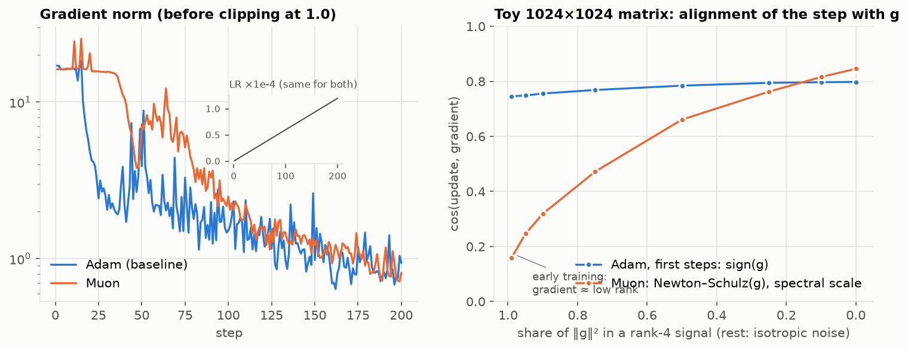
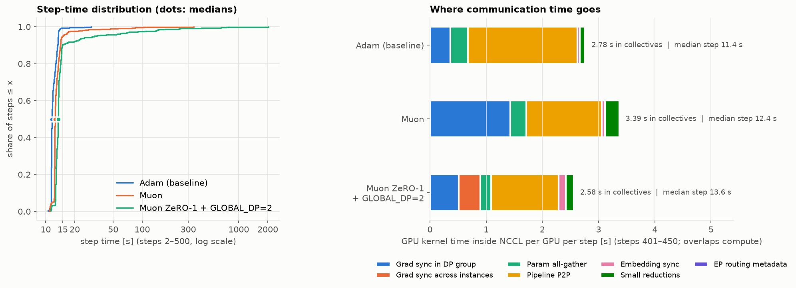
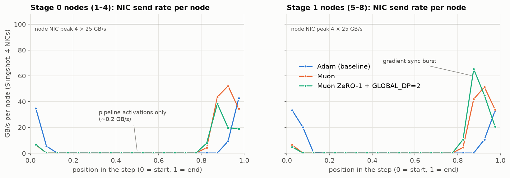
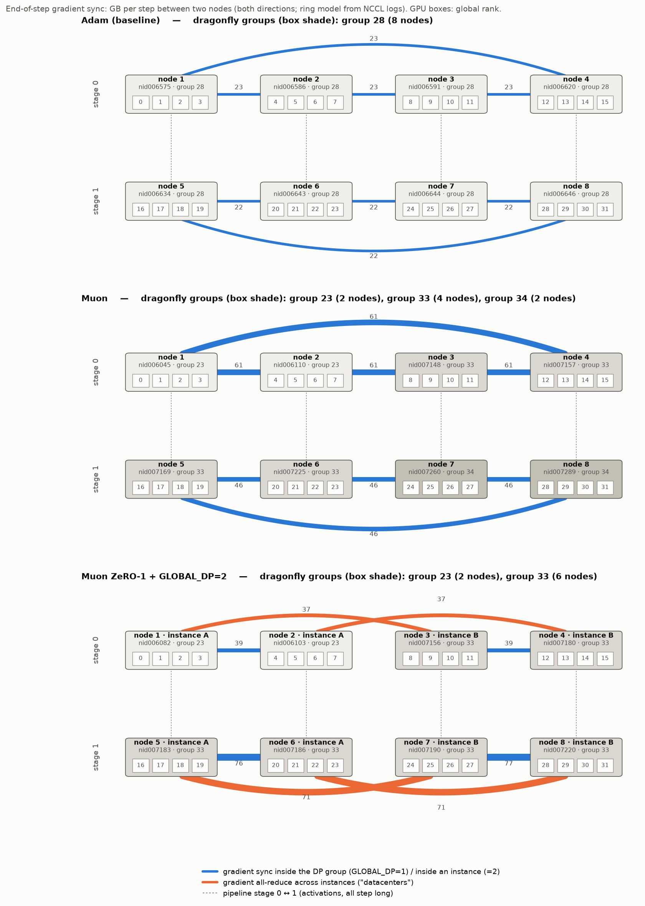
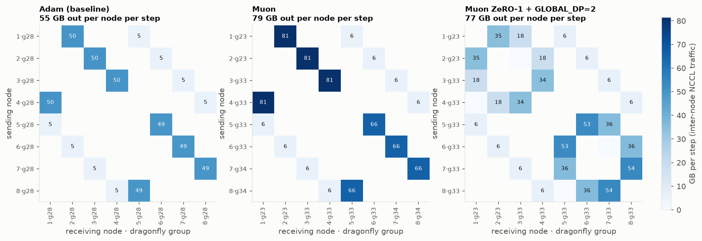

# Adam vs Muon vs Muon ZeRO-1 + GLOBAL_DP=2: the first 500 steps on 8 nodes

Analysis of logs only, 2026-10-21; no new jobs were run. All three runs use the same model (Qwen3.5-35B-A3B,
40 layers), data, batch (GBS 512 × 4,096) and LR schedule (warmup to 3e-4 over 500 steps). They also share
the parallel layout: TP 1, PP 2, EP 4 inside a node, DP 16.

| Run (W&B name) | Job | Optimizer | Nodes and Slingshot dragonfly groups | Steps |
|---|---|---|---|---|
| Adam, baseline (`train-q35a3b-gbs512to2560-sl4096`) | 3705060 | AdamW, ZeRO-1 | 8 nodes, all in group 28 | 1,008 (500 used here) |
| Muon (`…-sl4096-muon-max500`) | 3706874 | Muon (Kimi-K2 settings), no ZeRO | groups 23 / 33 / 34 (2 / 4 / 2 nodes) | 500 |
| Muon + GDP2 (`…-sl4096-muon-zero1-gdp2-max500`) | 3708048 | Muon, ZeRO-1 layer-wise, 2 optimizer instances | groups 23 / 33 (2 / 6 nodes) | 461 (hit the time limit) |

The data behind every figure is in `data/`, and the code that builds it is in `scripts/` (see the end of this
report).

## 1. Loss: Muon wins clearly after step ~60

- **By step 500, Muon is far ahead.**
  - Validation: Muon **2.536**, Adam 2.820 (perplexity 12.6 vs 16.8).
  - Training LM loss: 2.50 vs 2.81. MTP-1 loss: 2.82 vs 3.52.
- **Muon + GDP2 follows plain Muon's curve.** The difference is ≤ 0.03 at every step; the mean gap over
  steps 300–461 is +0.014.
- **Adam leads only during the first part of the warmup.**
  - LM loss: Adam is ahead until **step 62**. At its largest the gap is +2.2, around step 25 (Adam 10.1,
    Muon 12.3).
  - MTP-1 loss: Adam is ahead until **step 131**. The MTP head predicts t+2 from the trunk's hidden states,
    so it can only improve once the trunk has, and it lags the trunk.

### Why Adam is better at the beginning

This does not contradict the papers. They compare optimizers over a whole run, or at matched final loss, and
on that measure Muon wins here too, by the 0.28 validation gap above. Two things are behind the early gap.

1. **Same step size, worse direction while the gradient is low-rank.**
   - The step size isn't the difference. With `muon_scale_mode=spectral`, the update is
     `NS5(m) · sqrt(max(m, n))`, and every entry has RMS ≈ 1 × LR. Adam's first updates are ≈ `sign(g)`,
     also RMS 1 × LR. I checked `emerging_optimizers/.../muon.py` in the container image.
   - The difference is the direction.
     - Newton–Schulz sets *every* singular value of the update to ~1, including the many tiny ones that are
       mostly noise.
     - Early in training the useful gradient is low-rank: unigram and bigram statistics, pushing all
       logits in a few shared directions. Muon then spends most of its step budget on noise directions.
     - In a 1024×1024 toy (right panel), when 99% of ‖g‖² sits in a rank-4 signal, Adam's step has cosine
       **0.75** with g and Muon's only **0.16**, so Muon gets ~4–5× less first-order progress per step.
     - When the gradient is noise-like (bulk-dominated), both reach ~0.8.
   - Muon's grad norm (left panel) stays at ~15–16 until step ~35, while Adam's falls to ~2.4 by step 25.
     That's the plateau you'd expect if Muon has not yet followed the few dominant directions.
2. **The warmup makes the early phase long in steps.** The LR is only 6e-6 at step 10 and 3e-5 at step 50.
   Steps that make little progress per unit LR add up over the first ~60 steps. Once the easy low-rank part
   has been learned, gradients become higher-rank, and from there Muon's well-conditioned updates win. The
   gap is largest around steps 230–300 (−0.7 LM loss, −0.9 MTP) and then narrows as Adam catches up, to −0.3
   at step 500. Whether it keeps narrowing over a long run is not answered by 500 steps.

What this analysis can't settle: the toy covers the mechanism only. The real gradient spectra were not
logged. Muon was not tuned for this comparison: it uses the recipe's Adam LR 3e-4 and an extra scale of 1.0,
whereas Kimi-K2/Moonlight use 0.2·sqrt(max(m, n)) to match Adam's update RMS. A run that logs the singular
spectrum of a few gradient matrices during the first 100 steps would confirm the mechanism.

## 2. Time of one step

| | Adam | Muon | Muon + GDP2 |
|---|---|---|---|
| Step 1 (compilation, CUDA-graph capture) | 350 s | 336 s | 343 s |
| Median step, steps 2–461 | **11.6 s** | **12.5 s** | **13.5 s** |
| Median, steps 401–450 (the network window below) | 11.4 s | 12.4 s | 13.6 s |
| p90 | 13.3 s | 14.1 s | 14.8 s |
| Steps over 60 s | 0 | 2 (max 343 s) | 17 (max 2,040 s) |
| Time lost in stalls (steps over 2× the median) | 1 min | 9 min | **93 min** |
| Sum of steps 2–461 | 1.54 h | 1.79 h | 3.29 h |

- **The stalls are not network.** During them every GPU was idle in a 2 KB all-reduce, waiting for a late
  rank, and NIC traffic per step was unchanged (see WORKLOG). They are most likely host I/O on the shared
  filesystem.
- **Communication time per GPU (right panel) is 2.6–3.4 s per step**, measured as GPU kernel time inside
  NCCL; most of it overlaps compute.
  - The largest block is **pipeline send/recv, 1.2–1.9 s**. Its kernel time includes waiting for the other
    stage (the pipeline bubble), not only transfer.
  - **Gradient sync**: Adam 0.36 s (reduce-scatter only, ZeRO-1); Muon 1.42 s (full all-reduce, no ZeRO);
    Muon + GDP2 0.5 s within the instance + 0.39 s across instances.
- **The step-time ordering does not follow the communication time.** Muon + GDP2 spends the least time in
  collectives yet has the slowest steps.
  - The extra ~1 s of Muon over Adam is most likely the Muon optimizer step itself: Newton–Schulz on every
    matrix plus the parameter all-gather.
  - Placement also differs: the Adam run sat in a single dragonfly group.
  - The optimizer phase was not timed, so the split between these causes is not measured. The new
    level-1 timers (`optimizer`, `all-grads-sync`) will measure it in the next run.

## 3. What the final gradient all-reduce at GLOBAL_DP=2 costs

Phase-folding each node's per-second NIC counters over 50 steps shows the same pattern in all three runs:

- **The NIC is almost idle for ~80% of the step**: 0.2 GB/s, pipeline activations only.
- **All data-parallel traffic comes in one burst over the last ~20% (~2.5 s).** It peaks at 40–65 GB/s per
  node, half of the 4 × 25 GB/s NIC peak.
- **Adam has a second burst at the start of the next step**: the ZeRO-1 parameter all-gather, which overlaps
  the first forward micro-batches.

The all-reduce across instances, measured directly from the NCCL logs:

| | Stage 0 GPUs | Stage 1 GPUs |
|---|---|---|
| Partner | rank r ↔ r+8 (node 1↔3, 2↔4) | node 5↔7, 6↔8 |
| Calls per step | 108 (one per bucket, overlapped with the last backward) | 8 (one bucket; Megatron puts every stage after the first in a single bucket because it finishes its backward earlier) |
| Sent per GPU per step | 4.6 GB | 8.9 GB |
| GPU kernel time per step | **0.33 s** | **0.44 s** |
| When it finishes | last 20% of the step | last 20% of the step |

- **The cost is at most 0.33–0.44 s per step, ≤ 3.3% of a 13.6 s step**, even if none of it were hidden
  behind compute.
- **The measured gap to plain Muon is bigger than that.** Steps are 12.4 → 13.6 s, +1.15 s, more than the
  entire cross-instance kernel time. So most of the gap is not the cross-"datacenter" all-reduce. It comes
  from ZeRO-1 bookkeeping, the extra stage-1 volume (below) and different nodes.
- **A same-node test agrees.** In the 4-node toy A/B on identical nodes, GDP2 cost +8% vs GDP1. In the toy,
  communication is a larger share of the step.
- **What a real WAN would need:** about **108 GB per direction per step** crosses the boundary. Averaged over
  the step that is 8 GB/s (64 Gbit/s), but it is all sent in the ~2.5 s burst, so ~40 GB/s would be needed to
  stay off the critical path.
- **One more thing crosses the boundary: 660 tiny all-reduces per step.** These are the load-balancing token
  counts over the 16 GPUs of a stage. They are harmless on Slingshot, but on a link with milliseconds of
  latency they would add seconds per step. They are the first thing to localise in a real multi-datacenter
  setup.
- **Open anomaly:** stage-1 nodes send **104 GB per step against 67 GB on stage 0**. The NIC counters confirm
  it, and the other runs are symmetric (64/63 and 94/93 GB). Stage 1's per-GPU reduce-scatter (8.1 vs
  4.3 GB) and cross-instance all-reduce (8.9 vs 4.6 GB) are both ~2× stage 0's. Muon + GDP2 is the only run
  with the layer-wise ZeRO-1 layout, and it combines that layout with stage 1's single bucket. It is the prime
  suspect, but the cause is not confirmed yet. Losses are unaffected, since they match plain Muon.

## 4. Who talks to whom

**Layout.** Each node holds one EP group of 4 GPUs, and token dispatch uses HybridEP over NVLink; that
traffic never leaves the node. Stage 0 is nodes 1–4 (ranks 0–15) and stage 1 is nodes 5–8; stage s and
s+1 exchange activations between node i and i+4.

- **Experts:** GPU k of each node in a stage forms an expert-DP group of 4, one GPU per node (stride 4).
- **Dense layers:** the 16 GPUs of a stage form one DP group.

**GLOBAL_DP=2** splits each stage into instance A (nodes 1, 2 | 5, 6) and instance B (nodes 3, 4 | 7, 8):

- Expert DP becomes 2 within an instance (node 1↔2).
- Dense DP becomes 8 within an instance (2 nodes).
- The gradient all-reduce across instances pairs each GPU with the same GPU 2 nodes away.

Pipeline traffic and the embedding sync stay inside an instance by construction.

**Dragonfly.** Slingshot connects the nodes of a dragonfly group (~112 nodes here) directly through the
group's switches, and the groups to each other through global optical links that all jobs share. Slurm's
topology lists Clariden's groups (`scontrol show topology`). Where each run's end-of-step gradient sync
crossed groups:

- **Adam:** every node was in group 28, so the whole run stayed inside one group.
- **Muon:** the 4-node gradient rings cross groups. Stage 0's ring 1→2→3→4→1 crosses 23→33 and back;
  stage 1's ring crosses 33→34 and back. That is 61 GB (stage 0) and 46 GB (stage 1) per hop per step over
  the global links.
- **Muon + GDP2:**
  - In stage 0 the cross-instance pairs 1↔3 and 2↔4 run from group 23 to group 33, so the simulated
    "inter-datacenter" link really was an inter-group link. 37 GB per pair per step.
  - In stage 1, pairs 5↔7 and 6↔8 are both in group 33 (71 GB per pair per step, inflated by the anomaly
    above).
  - Within-instance traffic, 1↔2 and 3↔4, stays inside a group.

The node×node matrix shows every inter-node NCCL transfer per step. It is a ring model built from the NCCL
logs and recovers 85–90% of the bytes the NICs actually counted (`data/nic_vs_model.json`); the counters
also include background Ethernet traffic.

- **Muon and Adam:** a ring per stage; Muon's carries 66–81 GB per hop, Adam's ~50 GB.
- **Muon + GDP2:** a heavier within-instance pair plus a lighter pair across instances, and nothing to the
  other two nodes of the stage.

## Caveats

- One run per setting, on different nodes, in different dragonfly groups and at different times. Run-to-run
  step-time differences of a few % are within placement noise.
- NCCL kernel time includes waiting for the slowest peer and overlaps compute; it is an upper bound on
  communication cost, not exposed time.
- The NCCL logs (NETLOG=2) record no op start times. The placement of operations within a step comes from
  1-s dump times and 1-s NIC samples, so it is only accurate to ~1 s.
- The toy in section 1 illustrates a mechanism; it is not a measurement of these runs' gradients.

## Files

- `figures/`: the 6 PNG figures.
- `data/`, the tables behind them:
  - `steps.csv`: per step: time, loss, MTP loss, LR, grad norm, TFLOP/s.
  - `nccl_<run>.csv` and `comms_<run>.json`: every communicator, with members, hosts, and ops / GB / kernel
    seconds per step.
  - `placement_<run>.csv`, `nic_phase.csv`, `nic_vs_model.json`, `update_alignment.csv`.
- `scripts/`, to rebuild everything:
  1. `extract_steps.py`, `extract_nccl.py` and `extract_netmon.py` read the job logs, NCCL-inspector
     logs and netmon logs. Python 3.11 standard library only.
  2. `update_alignment.py` (toy, numpy) and `make_figures.py` (matplotlib).
