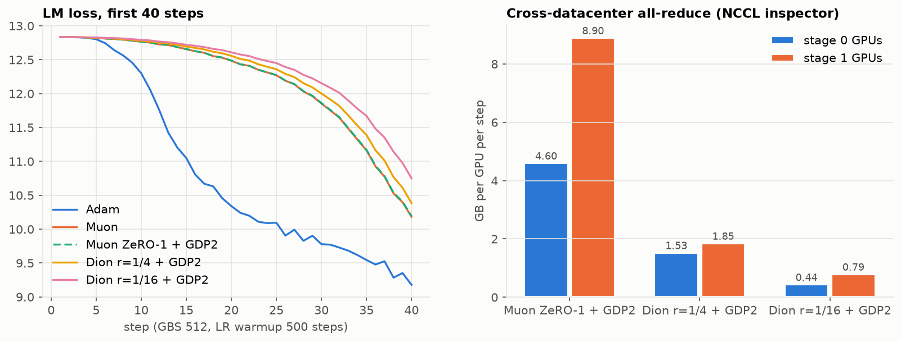

# Dion for the cross-datacenter gradient sync (GLOBAL_DP=2)

This experiment ran on 2026-10-28 and used 8.1 node-hours in total, all jobs in `WORKLOG.md`. It
asks one question: can Dion replace the once-per-step gradient all-reduce between the two
simulated datacenters, and only that?

## What was built

The code is the optional patch set `patches/optional/dion` (applied after `muon-zero1`) and is
launched with `OPTIMIZER=dion-zero1`. Dion (Ahn et al. 2025, arXiv:2504.05295) is implemented from
the paper in `megatron/core/optimizer/dion.py`; the authors' package is not used.

- **Inside a datacenter, nothing changes.** Gradients are reduce-scattered and parameters
  all-gathered as with Muon ZeRO-1, and every GPU owns whole weight matrices.
- **Between datacenters, the matrix gradients are no longer all-reduced.** Each datacenter keeps its
  own Dion momentum M_i. Per matrix, only P = B·Q (m×r) and R = Bᵀ·P (n×r) are summed across the two,
  so (m+n)·r values cross instead of m·n. The error feedback subtracts (1−μ)·P·Rᵀ/N.
- **This is exact, not an approximation.** The sum of the momenta follows single-datacenter Dion on
  the global gradient, so the weights stay identical in both datacenters. The unit tests and every
  sync check confirm it.
- **Everything else is as before.**
  - Embeddings, norms and the router stay on Adam, with the normal cross-datacenter all-reduce.
  - The update is scaled like our Muon, so a full-rank Dion step equals a Muon step.
- **Gradient clipping** uses √(N·Σ‖g_i‖²) over the datacenters. That equals the true norm when they
  agree, is an upper bound otherwise, and is the same in both.
- **Checkpoints average the momenta first**, which is a no-op for the algorithm. Q is re-seeded
  after a resume.
- **Speed:** equal-shape matrices are batched (stacked momentum, Cholesky QR2 in fp64). One step on
  a realistic per-GPU set of 1,296 matrices takes 116 ms at r=1/4 and 44 ms at r=1/16, against
  781 ms for Muon's Newton–Schulz.

## Verification

| Test | Result |
|---|---|
| Unit tests (4 GPUs): fp64 reference, 2 datacenters vs Dion on the summed gradient, momentum averaging, bf16 factors, rank-deficient matrices, layout mismatch | 14/14 pass. Errors ≤ 6×10⁻⁷ in fp32; weights bitwise identical across datacenters |
| Toy model, 4 nodes, PP 2: GLOBAL_DP=1 vs 2 | Loss equal to 3×10⁻³ (3.6×10⁻⁵ at step 20); grad norm 9.717 vs 9.718; weights identical |
| Toy model: save → restart → load (bf16, r=1/16) | Passes; weights identical before and after the restart |
| Full model, 8 nodes, real data, 40 steps, r=1/4 and r=1/16 | No OOM; weights identical at steps 10/20/30/40 |

The toy comparison found one bug, now fixed. The recipe averages inside its collectives, so the two
datacenters' unreduced gradients added up to 2× the global gradient. The losses could not show this,
because Dion's update ignores constant gradient scale, but the logged grad norm and the Adam
parameters' clip factor were 2× off.

## Results on the full model (8 nodes, GBS 512)

| | Muon ZeRO-1 + GDP2 | Dion r=1/4 + GDP2 | Dion r=1/16 + GDP2 |
|---|---|---|---|
| Cross-DC all-reduce per GPU per step, stage 0 | 4.60 GB, 108 calls, 334 ms | **1.53 GB** (3.0×), 16 calls, 90 ms | **0.44 GB** (10.5×), 6 calls, 24 ms |
| Same, stage 1 | 8.90 GB, 8 calls, 441 ms | **1.85 GB** (4.8×), 133 ms | **0.79 GB** (11×), 86 ms |
| NIC bytes sent per node per step (stage 0 / 1) | 67 / 104 GB | 54 / 75 GB | 49 / 70 GB |
| Median step, steps 5–20 / 31–40 | 11.47 / 14.07 s | **10.64 / 12.47 s** | **10.43 / 11.67 s** |
| Optimizer phase (W&B timer) | not measured | 0.53 s | 0.36 s |
| LM loss at step 40 (Muon: 10.18, Adam: 9.18) | 10.18 | 10.38 | 10.75 |

- **Bytes:** what is left at r=1/16 is mostly the Adam parameters' all-reduce (the embedding and
  output layers) plus the small factors.
  - The unexplained 2× stage-1 volume of Muon ZeRO-1 disappears once the matrices leave that
    all-reduce.
- **Steps are faster than with Muon.** Dion's optimizer step is much cheaper than Newton–Schulz.
  The runs used different nodes, so a few percent is within placement noise.
- **Loss: Dion runs slightly behind Muon early on.** A rank-r update carries √(r/min(m,n)) of
  Muon's update size: half at r=1/4, a quarter at r=1/16.
  - Whether it catches up, as the Dion paper reports, needs a longer run.
  - Raising the update scale or LR for low rank is a hyperparameter question; not tuned here.

## What this does not answer

- **Quality over a real run.** A 500-step comparison with the other runs would take
  `OPTIMIZER=dion-zero1 GLOBAL_DP=2 MAX_STEPS=500 WALLTIME=04:00:00 MAX_RESUBMITS=0 ./launch.sh train 8 1T`,
  about 25 node-hours. Not run.
- **Real WAN latency.** Dion needs 2 round trips per bucket per step: 6–18 calls instead of ~60–110.
  The 660 tiny load-balancing all-reduces per step also still cross the boundary; they are the next
  thing to localise.

Data: `data/` (per-communicator NCCL statistics, first-40-step losses and step times). Figure:
`scripts/make_figures.py`. Extraction: `analysis/2026-10-21-adam-muon-gdp2/scripts/extract_nccl.py --run ... --steps 21:40 --out data`.
