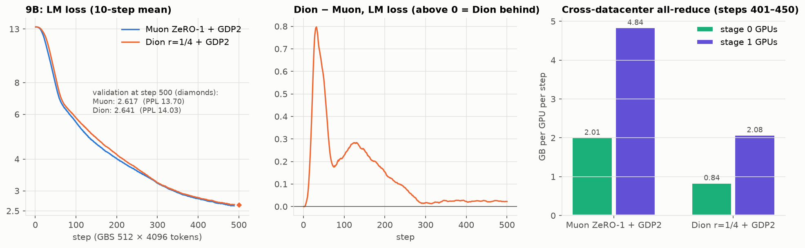

# Qwen3.5 dense models on Clariden: how to parallelize them cheaply

Measured on 2026-10-29. The jobs are listed in `WORKLOG.md` §7, and the table comes from
`tools/throughput_table.py <jobs>`. The goal is to pick, per model, the layout with the fewest
node-hours per token for the large-scale runs that follow.

**Setup.** Clariden nodes have 4 GH200 GPUs (96 GB HBM each), NVLink inside a node and 4×25 GB/s
Slingshot between nodes.
- All tests used sequence length 4096 and the 248k-token Qwen3.5 vocabulary.
- They used mock data, which for dense models runs at the same speed as real data (no expert
  routing).
- Each job ran 14–20 steps; the median step is taken from step 6 on.

## Results (2 nodes, Adam, GLOBAL_DP=1, 4 micro-batches per GPU)

| Model | Layout | Tokens/s per GPU | TFLOP/s per GPU | Node-h per 1B tokens | Free HBM (min) |
|---|---|---|---|---|---|
| 0.8B | TP1, MBS 1 | 32.5k | 216 | 2.14 | 58 GB |
| 0.8B | **TP1, MBS 2** | **34.5k** | 229 | **2.01** | 30 GB |
| 0.8B | TP1, MBS 4 / 8 | OOM | | | |
| 2B | TP1, MBS 1 | 20.5k | 311 | 3.39 | 46 GB |
| 2B | **TP1, MBS 2** | **21.8k** | 331 | **3.18** | 15 GB |
| 2B | TP1, MBS 4 | OOM | | | |
| 4B | **TP1, MBS 1** | **10.9k** | 339 | **6.34** | 23 GB |
| 4B | TP1, MBS 2 | OOM | | | |
| 9B | TP1, MBS 1 | OOM (also at 8 nodes, see below) | | | |
| 9B | TP2 (+SP), MBS 1 | 5.9k | 333 | 11.8 | 34 GB |
| 9B | **TP2 (+SP), MBS 2** | **6.3k** | 353 | **11.1** | 11 GB |
| 35B-A3B (MoE), for reference | EP4 PP2, 8 nodes, real data | 6.1k | 137 | 11.4 | 6 GB |

- **Memory, not compute, limits the micro-batch.** One extra sequence per micro-batch costs ~28 GB,
  even for the 0.8B.
  - The cause is the 248k-vocabulary logits: bf16 logits, their fp32 copy in the loss, and their
    gradient, for the main head and again for the MTP head.
  - MBS 2 is the most that fits up to 2B, and it is only ~6% faster than MBS 1. Larger micro-batches
    are not worth chasing.
- **TP is cheap inside a node.** At TP2 (NVLink, sequence parallel) the 9B runs at 353 TFLOP/s per
  GPU, as efficient as the 4B at TP1.
- **9B at TP1 does not fit,** not even at 8 nodes, where the optimizer state is sharded over
  16 GPUs (jobs 3789479/80). The first forward and backward pass complete, then NCCL cannot get
  buffer memory for the optimizer step.
- **The 9B dense costs as much per token as the 35B-A3B MoE** (11.1 vs 11.4 node-hours per 1B tokens).
- **GLOBAL_DP=2 adds no measurable time on 2 nodes.** Per-sample step time is the same in the
  GLOBAL_DP=2 tests (0.8B Dion, 2B Muon ZeRO-1, 4B Adam) as in the sweep.
  - It does need memory: each instance keeps its own optimizer state, sharded over half as many
    GPUs.
  - That is why 9B with GLOBAL_DP=2 runs out of memory on 2 nodes, with Adam and with Dion alike.

## Recommendations for the large runs

| Model | Adam / Muon (ZeRO-1) | Dion (needs TP=1) | Notes |
|---|---|---|---|
| 0.8B | TP1 PP1, MBS 2 | same | Any node count ≥ 2 with GLOBAL_DP=2 |
| 2B | TP1 PP1, MBS 2 | same | 15 GB free at MBS 2: keep MBS 2 |
| 4B | TP1 PP1, MBS 1 | same | |
| 9B | TP2 PP1, MBS 2 | TP1 **PP2**, MBS 1 | PP2 layout: see the 9B comparison below; ≥ 8 GPUs per instance |

**Commands:** `MODEL=<size> MBS=<mbs> [TP=2 | PP=2] OPTIMIZER=... GLOBAL_DP=... ./launch.sh train <nodes> <tokens>`.
Each model logs to its own W&B project, `qwen35-<size>-cscs`.

**Node count.** At a fixed global batch, the data-parallel traffic per GPU per step stays constant:
a reduce-scatter of the gradients plus an all-gather of the parameters, ≈ 4 bytes per parameter.
The compute per GPU per step shrinks as 1/nodes. Scaling therefore stays efficient while the
compute per step is several times the DP communication.

Rough limits at 512 sequences per step:

| Model | DP traffic per GPU per step | Efficient up to about |
|---|---|---|
| 0.8B | ~3 GB | 32 nodes |
| 2B–4B | | 16–24 nodes |
| 9B | ~36 GB | 8–16 nodes |

These are estimates, not measured for dense models. For comparison, the MoE was measured at 91–94%
efficiency on 16 nodes and ~85% on 32. The batch ramp to 2,560 sequences moves every limit up by 5×.
To spend the fewest node-hours, use the fewest nodes that still meet the wall-clock target.

## 9B: Dion vs Muon (GLOBAL_DP=2, 4 nodes, TP1 PP2, 500 steps)

**Setup.** Both runs use the setup of the 35B comparison: real data, the batch schedule from 512
sequences, LR 3e-4 after a 500-step warmup, and 500 steps with validation at step 500.
- Jobs: 3789784 (Muon ZeRO-1) and 3789785 (Dion r=1/4, bf16 factors).
- Layout: 4 nodes, GLOBAL_DP=2, TP1 PP2, MBS 1.
- At this size each "datacenter" is one node per pipeline stage.
- W&B project: `qwen35-9b-cscs`.

| | Muon ZeRO-1 + GDP2 | Dion r=1/4 + GDP2 |
|---|---|---|
| Validation loss at step 500 | **2.617 (PPL 13.70)** | 2.641 (PPL 14.03) |
| Training LM loss at 500 (10-step mean) / MTP loss | 2.601 / 2.883 | 2.623 / 2.956 |
| Training loss gap (Dion − Muon) at steps 25 / 100 / 200 / 300 / 500 | | +0.65 / +0.23 / +0.15 / +0.02 / +0.02 |
| Weights identical across the 2 datacenters | (exact all-reduce) | yes, all 5 checks |
| Median step (GBS 512) | 22.31 s | **22.00 s** (−1.4%) |
| Tokens/s per GPU, TFLOP/s per GPU | 5,874, 331 | 5,957, 336 |
| Cross-DC all-reduce per GPU per step, stage 0 / 1 | 2.01 / 4.84 GB | **0.84 / 2.08 GB** (2.4× / 2.3× less) |
| Gradient sync left after the backward (timer) | 0.185 s | **0.085 s** |
| Optimizer step (timer) | 0.229 s | 0.221 s |
| Training time to step 500, node-hours of the job | 3.28 h, 14.1 | 3.24 h, 13.9 |
| Fullest GPU's free HBM | 11.2 GB | 10.7 GB |

- **Quality: Dion trails Muon early, then nearly closes the gap.** It is behind most in the first
  ~50 steps of the warmup, as in the 35B. From step 300 on it is within 0.02–0.03, and the validation
  loss at step 500 is 0.9% higher.
  - Dion's update was scaled like Muon's, with the same LR. A rank-1/4 update therefore carries half
    of Muon's update size; this was not tuned.
- **Cross-datacenter traffic falls 2.3–2.4×.** That is less than on the 35B MoE (3.0–4.8×), because
  the dense model's large Adam-managed tensors keep the full all-reduce. Those are the 248k×4096
  embedding and output layers, ~1B parameters each.
- **Stalls:** both runs hit the same three slow steps (~93, ~168, ~195) at the same times. That is
  the shared filesystem or network, not the optimizers.
- **Memory:** 4 nodes are enough for 9B with GLOBAL_DP=2 at PP2. 8 nodes would only finish sooner,
  for about the same node-hours.

