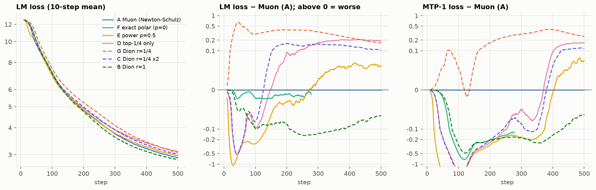
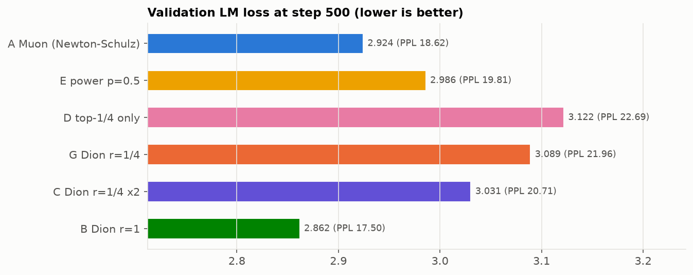
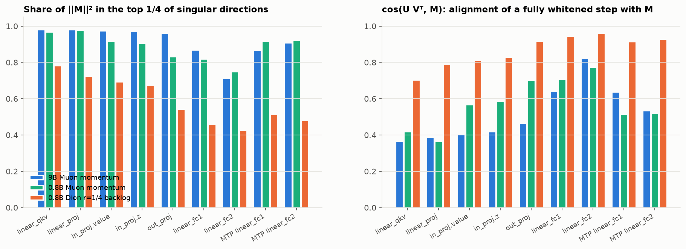

# Why is Dion behind Muon, and do the small singular directions matter?

Experiments of 2026-10-31 and 2026-11-01 on Qwen3.5-0.8B, with momentum spectra from the 9B and 0.8B checkpoints.
Jobs are listed in `WORKLOG.md` §8 and runs are in the W&B project `qwen35-0.8b-cscs`. The figures and
CSVs are produced by `scripts/analyze.py` (W&B), `scripts/spectra_figure.py` (checkpoint spectra) and
`scripts/dion_full_rank_sim.py` (toy).

**The question.** On 9B, Dion (rank 1/4) trailed Muon at every step: validation loss 2.641 vs 2.617
at step 500, MTP acceptance 45.9 vs 46.7%. The user's view is that directions with small singular
values are not that important, so a low-rank update should lose little. Seven 0.8B runs separate
the possible causes.

## Answer in short

1. **Most of Dion's gap is the rank.** At 0.8B the step-500 validation gap is +0.165. Restoring
   Muon's step size takes back 0.059 of it. At the same step size, going from rank 1/4 to full rank
   takes back 0.169. Full-rank Dion is even 0.062 *better* than Muon.
2. **The small directions matter after the first ~150 steps.**
   - **The direct test of the hypothesis is run D.** It is Muon restricted to the top quarter of
     singular directions, at Muon's step size. The discarded directions hold only 13% of the
     momentum's energy.
   - D is the *worst* run at step 500: validation loss +0.198 above Muon, PPL 22.7 vs 18.6. It
     leads by 0.43 at step 50, falls behind at step ~150, and its gap grows to ~0.20 by step 350
     and stays there.
   - Every other variant that gives the weak directions less weight shows the same crossover:
     - power 0.5 (E): −0.93 at step 25, +0.061 at step 500;
     - Dion rank 1/4 at Muon's step size (C): −0.39 at step 50, +0.10 at step 500.
   - The MTP head is hurt most.
3. **The user's premise is right; the conclusion does not follow.** The momentum really is
   concentrated: 87% (0.8B) and 93% (9B) of its energy lies in the top quarter of directions.
   - But gradient size is not the value of a step. The large directions are high-curvature
     directions, and there the step is already limited by stability.
   - Progress comes from the many weak directions, and Muon's whitening exists to amplify exactly
     those (see "Why").
4. **The gap shrinks with model size, as the Dion paper reports.** It is +0.165 at 0.8B and +0.024
   at 9B.
   - The 9B momentum is more concentrated (effective rank 7% vs 15% of the dimension), so rank 1/4
     captures more of it.
   - For cross-datacenter Dion on the large models, rank 1/4 is a reasonable trade. The update
     should be scaled ×2.

## The runs

0.8B, 2 nodes, GLOBAL_DP=2 (two "datacenters"), MBS 2.
- Setup as for the 9B/35B comparisons: real data, batch ramp from 512 sequences, LR warmup to 3e-4
  over 500 steps, 500 steps.
- Validation at steps 250 and 500.
- One seed per run, same data order.

All runs use Muon's momentum (0.95, Nesterov), LR, weight decay and per-shape scale, unless noted.

| Run | What changes | What it tests |
|---|---|---|
| A Muon | Newton–Schulz, 5 quintic steps (the baseline) | |
| F exact polar | exact U Vᵀ from an fp64 eigendecomposition (power p = 0) | Newton–Schulz inexactness |
| E power 0.5 | step U diag(s^0.5) Vᵀ, rescaled to Muon's Frobenius norm | partial whitening: weak directions get less |
| D top 1/4 | U Vᵀ restricted to the top 1/4 of directions, rescaled to Muon's norm, no error feedback | the user's hypothesis, directly |
| G Dion r=1/4 | the 9B setting: rank 1/4, step size as for Muon's spectral scale (half of Muon's Frobenius norm) | |
| C Dion r=1/4 ×2 | as G with the update ×2, which restores Muon's Frobenius norm | step size vs rank |
| B Dion r=1 | full-rank Dion | Dion's mechanics without the rank limit |

## Results

| Run | Val 250 | Val 500 (PPL) | Train LM gap to A at step 50 / 200 / 500 | MTP loss at 500 (gap) | MTP acceptance | Median step / optimizer |
|---|---|---|---|---|---|---|
| A Muon | 4.206 | 2.924 (18.62) | – | 3.283 | 43.1% | 7.47 s / 0.04 s |
| B Dion r=1 | **4.049** | **2.862 (17.50)** | −0.05 / −0.09 / **−0.065** | **3.220 (−0.063)** | **43.7%** | 7.52 / 0.10 |
| F exact polar | 4.190 | – (stopped at step 278) | −0.02 / −0.01 / – | | | 7.87 / 0.45 |
| E power 0.5 | 4.181 | 2.986 (19.81) | **−0.38** / −0.03 / +0.061 | 3.358 (+0.075) | 42.5% | 8.02 / 0.45 |
| D top 1/4 | 4.306 | 3.122 (22.69) | **−0.43** / +0.10 / +0.192 | 3.450 (+0.167) | 41.6% | 8.06 / 0.45 |
| C Dion r=1/4 ×2 | 4.340 | 3.031 (20.71) | **−0.39** / +0.16 / +0.104 | 3.400 (+0.117) | 41.9% | 7.56 / 0.03 |
| G Dion r=1/4 | 4.586 | 3.089 (21.96) | +0.61 / +0.40 / +0.165 | 3.538 (+0.255) | 40.4% | 7.51 / 0.03 |

Train LM loss is a 10-step mean. Steps are the median from step 20 on, excluding the stalls (see
caveats). D, E and F pay +0.41 s per step for fp64 eigendecompositions. They are measuring
instruments, not candidates for production. F's resume from step 278 never started: the account
expired while it was queued. So F has no step-500 numbers.

**Where Dion's gap comes from** (validation loss at step 500):

| Step | Change | Δ val loss |
|---|---|---|
| G → C | step size ×2 (Muon's Frobenius norm) | −0.059 |
| C → B | rank 1/4 → full, same Frobenius norm | **−0.169** |
| B → A | full-rank Dion → Muon | +0.062 |
| G → A | total | −0.165 |

- **Rank costs the most, and step size about a third as much.** Our G uses the Dion paper's
  convention (spectral norm 1 at every rank), so its rank-1/4 step carries only half of Muon's
  Frobenius norm. The paper found the best LR at rank 1/4 to be about Muon's. Here, in a run that
  is entirely LR warmup, doubling the step still helps.
- **Full-rank Dion is not the reason Dion trails; it beats Muon.**
  - The toy below shows that a full-rank Dion step is Muon's polar step (cos 0.985–0.988 with U Vᵀ).
    So B differs from A only in how exactly it whitens, in heavy-ball vs Nesterov momentum, and in
    the fused QKV.
  - Exact whitening (F) is only 0.01–0.02 ahead of A up to step 250, while B is ahead by 0.09–0.13.
  - So most of B's lead is from the momentum form, the fused QKV, or seed noise. One seed cannot
    separate these.
- **The MTP head suffers most from low rank.** At step 500 its gap is +0.255 for G (LM +0.165) and
  +0.117 for C (LM +0.104).
  - G's MTP gap was still growing until step ~380, while its LM gap had been shrinking since step 200.
  - C, D and E have a *lower* MTP loss than Muon until step ~380. Then, within ~30 steps, Muon's
    MTP loss drops faster and all three fall behind.
  - At 9B the persistent MTP gap (acceptance 45.9 vs 46.7%) is the same effect, smaller.

**What happens to the discarded part matters as much as how much is discarded.** The three runs
at Muon's step size give the weak directions three different fates. The gaps are validation loss
at step 500, against A.

| Run | Fate of the bottom 3/4 of directions | Gap at 500 | Gap trend, steps 300 → 500 |
|---|---|---|---|
| D | never applied | +0.198 | +0.17 → +0.19 (flat at ~0.20 from step 350) |
| C | applied late, through Dion's error feedback once they reach the top quarter | +0.106 | +0.16 → +0.10 (closing) |
| A (Muon) | applied every step at full weight | 0 | |
| B | full-rank Dion | −0.062 | |

C and D also differ in subspace tracking (one power iteration vs exact) and momentum form. Error
feedback is the large difference: without it the tail is never learned and the gap stays.

## Do the small singular directions matter?

**Yes, after the first ~150 steps; before that, concentrating the step is better.** Three
interventions give the weak directions less weight than Muon at the same step size: E, C and D. All
show the same crossover (train LM loss, 10-step mean).

- **D (top 1/4 of Muon's directions, no error feedback)** is the cleanest test. It leads by 0.43 at
  step 50 and falls behind at step 149.
  - From step 350 on it is ~0.20 behind (val +0.198, MTP +0.167, acceptance 41.6 vs 43.1%).
  - Dropping 13% of the momentum's energy costs more than anything else we tried.
- **C (rank 1/4, Muon's step size)** leads by 0.39 at step 50, falls behind at step 126, and ends
  +0.104.
- **E (s^0.5)** keeps every direction but weights it by √s. It leads by 0.93 at step 25 and falls
  behind at step 272 (+0.061 at step 500, MTP +0.075). It is milder than D, as expected.
- The opposite direction, weighting the weak directions *more exactly* than Newton–Schulz, is never
  worse than Muon: F up to step 278 is −0.01 to −0.02, and B is −0.062 at 500.

**What the momentum looks like** (`figures/spectra.png`). These are singular values of the saved
momentum at step 500, layers 0/8/16/24/31 and the MTP layer, medians over matrices.

| Checkpoint | Energy in the top 1/16 / 1/4 / 1/2 of directions | Effective rank / dim | cos(U Vᵀ, M) |
|---|---|---|---|
| 9B Muon momentum | 0.74 / 0.93 / 0.98 | 0.07 | 0.56 |
| 0.8B Muon momentum | 0.62 / 0.87 / 0.96 | 0.15 | 0.66 |
| 0.8B Dion r=1 buffer (= μ·momentum at full rank) | 0.59 / 0.85 / 0.96 | 0.20 | 0.68 |
| 9B Dion r=1/4 backlog (error feedback) | 0.50 / 0.78 / 0.93 | 0.27 | 0.75 |
| 0.8B Dion r=1/4 backlog | 0.32 / 0.65 / 0.87 | 0.51 | 0.85 |

- **The gradient energy is in a few directions.** Only 7–13% of it lies outside the top quarter.
- **Muon's step goes mostly into the other directions.** A polar step gives every direction weight
  1, so 75% of its squared norm lands in the bottom three quarters. Its cosine with the momentum is
  only 0.56–0.66.
- **That spread of the step is what wins after step ~150.**
- **The spread varies by module.**
  - Attention QKV/proj and the GDN value/z projections are the most concentrated (0.97–0.98 in the
    top quarter at 9B).
  - MLP fc2 is the widest (0.71 at 9B, 0.75 at 0.8B), then fc1.
  - At 0.8B the MTP layer's MLP is also wide.
- **Dion's backlog is nearly flat, largest where the spectrum is wide.**
  - It is the part of the momentum that rank 1/4 has not applied yet.
  - At 0.8B its effective rank is half the dimension.
  - The backlog is largest in fc1/fc2 (top-quarter energy 0.43–0.46), the GDN out_proj (0.54) and
    the MTP MLP (0.48–0.51). This matches where the loss gap is.

**Toy: what spectrum does a Dion step apply?** The script `scripts/dion_full_rank_sim.py` (job
3815724) uses a 512×256 matrix. Its gradient is a rotating rank-32 signal with power-law strengths
plus noise, and the momentum is 0.95.

| Rank | cos(step, U Vᵀ) | Weight per direction | Step in B's top 1/4 |
|---|---|---|---|
| full | 0.985–0.988 | ∝ s^0.07–0.12 (polar: s^0) | 28% (polar: 25%) |
| 1/4 | 0.50 (= √(1/4): the top slice of U Vᵀ) | – | 82–86% |

- One warm-started power iteration per step tracks the singular vectors well enough. Full-rank
  Dion *is* Muon's step, even when the signal rotates fast.
- At rank 1/4, 14–18% of the step falls outside the momentum's top quarter, because the subspace
  lags. Orth-Dion makes the same point about Dion's column normalization.

## Why the weak directions matter

- **Gradient size is not the value of a step.** On a quadratic model, a step along direction i
  gains at most g_i²/(2h_i), where h_i is the curvature.
- **The large-gradient directions are the high-curvature ones.** The gradient aligns with the top
  Hessian eigenvectors (the "dominant subspace"). Along them the step size is capped by stability:
  training sits at the edge of stability and bounces there.
- **Song, Ahn and Yun (ICLR 2025) tested this directly.**
  - Restricting SGD to the dominant subspace stops the loss from decreasing.
  - *Removing* the dominant component works about as well as the full update.
  - The loss decreases through the bulk of weak directions.
- **This is what Muon's whitening is for.** U Vᵀ = (GGᵀ)^{-1/4} G (GᵀG)^{-1/4} is a Shampoo-type
  preconditioner. It assumes curvature grows with the gradient's spread, so it boosts the weak,
  low-curvature directions most.
- **Down-weighting them helps only while the gradient is essentially low rank.** That is the first
  ~100–150 steps, when it is dominated by unigram/bigram statistics and the LR is still tiny. There
  D, C and E win by a lot.
  - D shows what happens afterwards: a fixed loss of ~0.2 that does not close.
  - With error feedback (C) the loss closes slowly, because the weak directions are learned late.
- **There is also a data view.** Wang et al. (ICLR 2026) find that Muon's advantage over Adam
  comes from the associative-memory weights (attention value/output and the FFN).
  - Muon's near-isotropic spectrum learns rare ("tail") associations, where Adam and other
    spectrum-preserving updates favour frequent ones.
  - Our largest backlogs and losses are in exactly those places: FFN fc1/fc2 and the MTP layer.
    MTP predicts the token after next, which is harder and closer to the tail.
- **Scale.** The 9B momentum is more concentrated than the 0.8B (effective rank 7% vs 15%), so
  rank 1/4 leaves less behind. The Dion paper reports the same trend: at 3B, ranks 1/2 and 1/4
  match Muon, and the rank-1/16 gap narrows with size. Our gap falls from +0.165 (0.8B) to +0.024
  (9B, earlier run).

## Caveats

- **One seed per run.** A and F are nearly the same algorithm with the same seed and data and
  differ by 0.01–0.02. Seed-to-seed spread is not measured, so differences below ~0.03 are not
  significant.
- **All 500 steps are LR warmup.** The LR reaches 3e-4 only at step 500, so these runs do not show
  the peak-LR or decay phase. Variants that concentrate the step act like a larger effective LR
  along the top directions, which favours them while the LR is small. Gaps after the peak may be
  smaller or larger.
- **Data-loader stalls** on the shared filesystem cost 50–123 min per run (one rank blocked in
  `next(data_iterator)`, up to 1,780 s per step).
  - They change wall time and node-hours, not losses.
  - They made the first D job time out at step 1, and F hit its walltime at step 278.
  - The D rerun (job 3812935, overnight) had no stalls: 500 steps in 1 h 21 min.
  - The F resume (job 3815609) waited 14.5 h in the queue. When the account expired on
    2026-11-01 it became ineligible (`InvalidQOS`) and was cancelled; it never started.
- **Node-hours.** The experiment used 35.0 node-hours in total, against ~15 planned; the
  difference is the stalls. F's missing 222 steps would cost ~1.5 node-hours. They are not needed
  for the conclusions, and they cannot be run on this account.

## Recommendations

1. **Cross-datacenter Dion for the large runs: rank 1/4 with `DION_SCALE=2`.** At 0.8B the ×2 is
   worth 0.059 at no cost. Check it once on 9B (4 nodes, ~14 node-hours) before the big runs.
2. **Give the wide modules more rank** if the gap matters: MLP fc1/fc2 and the MTP layer, e.g.
   1/2. The attention/GDN projections can take less, e.g. 1/8. Cross-datacenter traffic stays about
   the same. This needs a per-module rank option (not implemented yet).
   - Full rank saves no traffic: (m + n)·k values against m·n, which is 2× more for a square
     matrix.
3. **For optimizer comparisons on 0.8B–2B, use Muon or Dion r ≥ 1/2.** Rank 1/4 costs 0.17 there.
4. **Do not pursue truncated or partially whitened Muon (top-f, power p > 0)** as an improvement.
   Its gain is real but limited to the first ~150 steps, and truncation without error feedback
   costs ~0.2 afterwards. A short schedule (p = 0.5 for ~100 steps, then polar) could keep the early
   gain but is worth little.
5. **Low-rank compression must keep error feedback** (Dion has it). D shows the cost of dropping
   the residual instead.
6. **Before drawing conclusions for production, run past the warmup.** Two runs (Muon, Dion r=1/4
   ×2) of ~2,000 steps on 0.8B would show whether the gap closes after the LR peak, as it did on 9B.
7. **Fix the data stalls** (prefetch the tokenized data to node-local storage or capstor). They now
   cost more node-hours than the optimizers differ by.

## References

- K. Ahn, B. Xu, N. Abreu, J. Langford, "Dion: Distributed Orthonormalized Updates",
  [arXiv:2504.05295](https://arxiv.org/html/2504.05295v3); Microsoft Research
  [blog](https://www.microsoft.com/en-us/research/blog/dion-the-distributed-orthonormal-update-revolution-is-here/).
- M. Song, K. Ahn, C. Yun, "Does SGD really happen in tiny subspaces?", ICLR 2025
  ([ICLR](https://iclr.cc/virtual/2025/poster/27933)).
- S. Wang, F. Zhang et al., "Muon Outperforms Adam in Tail-End Associative Memory Learning",
  ICLR 2026, [arXiv:2509.26030](https://arxiv.org/pdf/2509.26030).
- Orth-Dion, "Eliminating Geometric Mismatch in Distributed Low-Rank Spectral Optimization",
  [ICML 2026](https://icml.cc/virtual/2026/75820).
